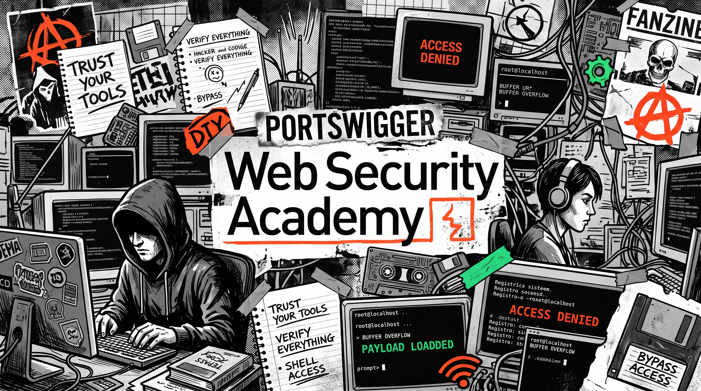

# PortSwigger Web Security Academy

Este repositório contém minhas anotações, documentações e resoluções práticas dos laboratórios da [Web Security Academy da PortSwigger](https://portswigger.net/web-security). O objetivo principal é registrar minha jornada de aprendizado em cibersegurança e manter um guia de consulta rápida sobre diversas vulnerabilidades web, como SQL Injection, CSRF, SSRF, e falhas de autenticação.

