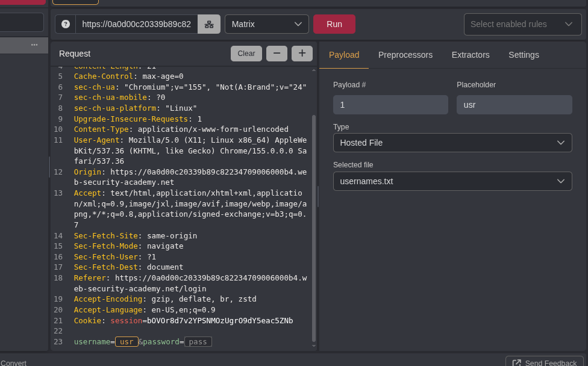
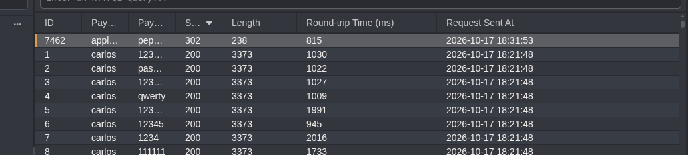
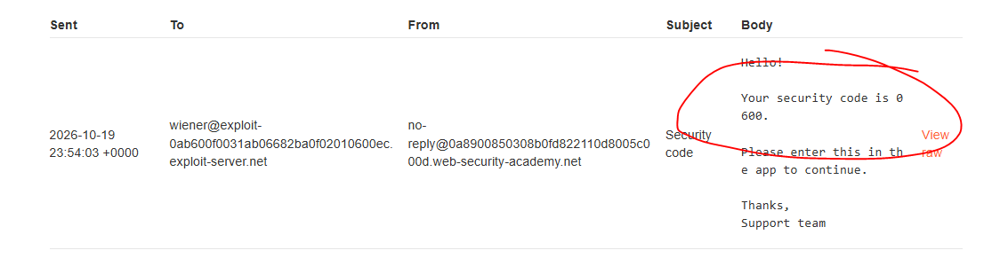
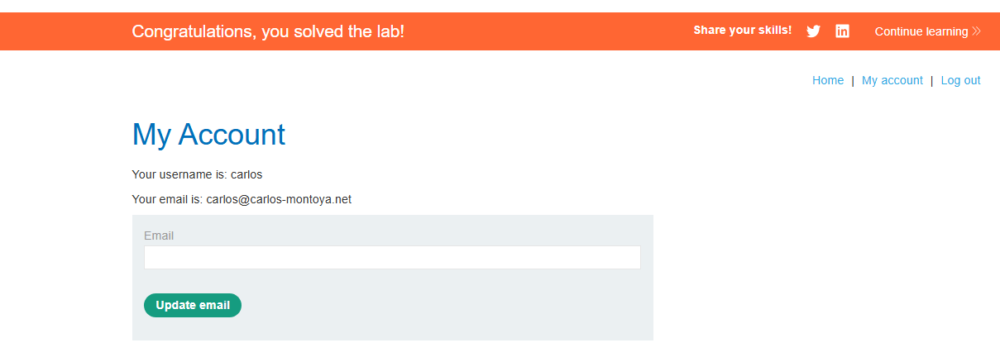

# Authentication

**Vulnerabilidades de autenticação (_authentication vulnerabilities_)** surgem quando uma aplicação falha em verificar corretamente a identidade de quem tenta acessá-la, de/por mecanismos fracos (como senhas previsíveis e ausência de limite de tentativas), a falhas de lógica (p. ex., *bypass* de 2FA). Por darem acesso direto a contas, essas falhas costumam ter um alto impacto. Os labs a seguir mostram, na prática, enumeração de usuários, força bruta e contorno de 2FA.

### 📚 Referências e leituras recomendadas:

-   [OWASP Top 10:2021 – A07: Falhas de Identificação e Autenticação](https://owasp.org/Top10/2021/pt-BR/A07_2021-Identification_and_Authentication_Failures/)
-   [OWASP Top 10:2021 – A01: Quebra de Controle de Acesso](https://owasp.org/Top10/2021/pt-BR/A01_2021-Broken_Access_Control/)
-   [Authentication vulnerabilities](https://portswigger.net/web-security/authentication) 
-   [Vulnerabilities in multi-factor authentication](https://portswigger.net/web-security/authentication/multi-factor)
-   [Access control security models](https://portswigger.net/web-security/access-control/security-models)
-   [CWE-287: Improper Authentication](https://cwe.mitre.org/data/definitions/287.html)

----------

## Lab 1: Username enumeration via different responses

> **Objetivo:** (A) descobrir um nome de usuário válido por enumeração e, assim, uma senha válida por força bruta, (B) conseguindo acesso à conta do usuário.

Após dar uma longa olhada na página inicial da aplicação web (inclusive no código-fonte), com alguns posts e comentários, parti para os _finalmentes_, já que esse recon não teve qualquer retorno.

No Caido, interceptei uma requisição de um formulário de login enviada pelo navegador, na qual pudemos alterar os parâmetros `username=Y&password=Z`, adicionando como entrada as duas wordlists disponibilizadas na plataforma, [usernames.txt](https://portswigger.net/web-security/authentication/auth-lab-usernames) e [passwords.txt](https://portswigger.net/web-security/authentication/auth-lab-passwords), e lançando o payload em modo Matrix, via Automate.

Em outras palavras, _run_ num ataque de força bruta ao formulário de login!

O mesmo, mais ou menos como demonstrado no Caido¹, poderia ser feito no Burp Suite, via Intruder. Teríamos, da mesma maneira, as credenciais de acesso, identificáveis pelo retorno `status 302`, `length 230`.

Uma estratégia ainda mais simples e rápida poderia ser adotada: lançando um payload apenas para o campo `username`, chegaríamos logo a um... usuário válido. O mesmo vale para o campo `password`, mas, dessa vez, já teríamos a senha, completando as credenciais de acesso, sem testar algumas dezenas de senhas para cada um de algumas dezenas de usuários.

Bem, era tarde e eu estava com sono, rs.

## Lab 2: 2FA simple bypass

> **Objetivo:** (A) contornar a autenticação por dois fatores (2FA)² a partir das credenciais de `wiener` e `carlos:montoya`, acessando a conta do usuário.

A primeira coisa que fiz foi logar com uma conta de usuário: a de Wiener, que, inclusive, já contava com 2FA. Pensei, a princípio, em interceptar, desde já, essas requisições, mas tive a sensação de que a coisa poderia ser muito mais simples. E era, de fato!

Ao acessar o e-mail de Wiener, vemos o código de verificação necessário para validar o login, `0600`:

Ao logar com a conta de Carlos, dá-se o mesmo: uma nova 2FA, mas, dessa vez, não temos acesso a e-mails nem ao código de verificação. **O que se espera num cenário como esse é que o acesso à conta só nos seja concedido após a verificação**, isto é, se passássemos pela 2FA. **O que nem sempre acontece**.

Ao acessar a conta de Wiener, temos acesso a um painel que, presumo, seja comum aos usuários comuns, como... Carlos. Ao acessar a URL desse painel (`/my-account?id=carlos`) e, levando em consideração que, em tese, ainda precisávamos de um código, temos acesso também à conta de Carlos, nosso alvo. Feito!

----------

¹ Por enquanto, optei pelo Caido, por ser uma aplicação semelhante ao Burp, que já uso há algum tempo. Fundamentalmente porque sua versão gratuita me é menos restritiva que a Community do Burp.

² A chamada autenticação de dois fatores ou 2FA, é mecanismo de segurança que exige duas categorias distintas de prova de identidade para conceder acesso, combinando algo que você sabe (senha, PIN) com algo que você tem (token, app autenticador, SMS) ou é (biometria), de modo que, uma senha, se comprometida, não deveria bastar para invadir uma conta.
